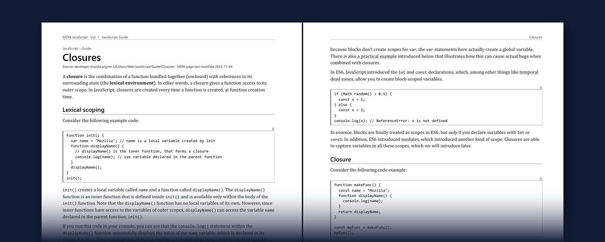

<picture>
  <source media="(prefers-color-scheme: dark)" srcset="art/masthead-dark.svg">
  <source media="(prefers-color-scheme: light)" srcset="art/masthead-light.svg">
  
</picture>

<a href="art/README.md">How the mark is drawn</a>

# Sami Islam

I turn large technical documentation into books you can study on paper, and I write the checks that prove nothing was lost on the way.

### [MDN’s JavaScript docs as nine books, checked line by line](https://github.com/sami12344/mdn-javascript-print-edition)

The whole JavaScript section of MDN, 1,346 articles, laid out as 3,744 A4 pages for people who learn better on paper. My favourite decision is in the checker: it doesn’t trust the HTML I generated, so it pulls every code line back out of the finished PDFs, indentation included, and compares it with MDN’s source. All 6,857 code blocks pass.

[Read Volume 1 (PDF)](https://github.com/sami12344/mdn-javascript-print-edition/blob/main/volumes/MDN-JavaScript-Vol01-Guide.pdf) · [See the code-line check](https://github.com/sami12344/mdn-javascript-print-edition/blob/main/generator/verify.py#L267-L319) · [Verification report](https://github.com/sami12344/mdn-javascript-print-edition/blob/main/verification/VERIFICATION-REPORT.md)

#### Selected work

**[TypeScript’s documentation as eight books](https://github.com/sami12344/typescript-docs-print)**: the handbook, references and release notes in 1,492 pages, made so I could learn TypeScript properly. The website’s samples are interactive, so the books print what it shows: compiler errors sit under the code with their line and error code, and samples that are meant to fail still fail. [Download page](https://sami12344.github.io/typescript-docs-print/)

#### Currently exploring

I’m reading those TypeScript books cover to cover so that my next projects can be full-stack TypeScript products. Later I want to work on applied AI that teaches physics and mathematics, and that shows its working the way these books do.
