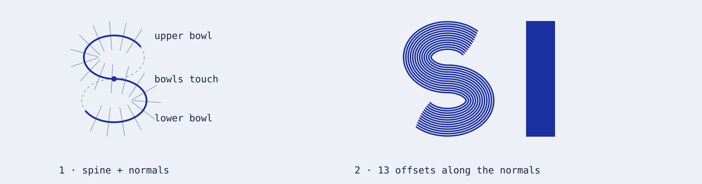

# How the mark is drawn

The SI at the top of my profile is generated by [`masthead.mjs`](masthead.mjs), about 140 lines of plain JavaScript with no dependencies. I made it for this profile.



1. **One curve.** The S is a single centre line. It starts at the upper right, runs counter-clockwise around an ellipse to the point where a second ellipse sits underneath, then clockwise around that one to the lower left. The upper ellipse is 7% narrower, as in most typefaces.
2. **Thirteen copies.** The script samples the curve 480 times, works out the normal at each sample, and draws 13 copies of the curve, each shifted a fixed distance along those normals. Together they fill the same width as the I.
3. **A clean cut.** Each copy starts and stops a few samples later than the one beside it, so both ends of the S finish on a diagonal.

At phone size the thin lines blur into a solid S; on a wide screen you can see the construction.

## Change it

Every proportion is a named constant at the top of the file (`CAP`, `STROKE`, `LINES`, `RX`, `GAP`, and the start and end angles). Edit one and run:

```bash
node art/masthead.mjs
```

It rewrites `masthead-dark.svg`, `masthead-light.svg` and `construction.svg`. The colours for both themes are in `THEMES`.
